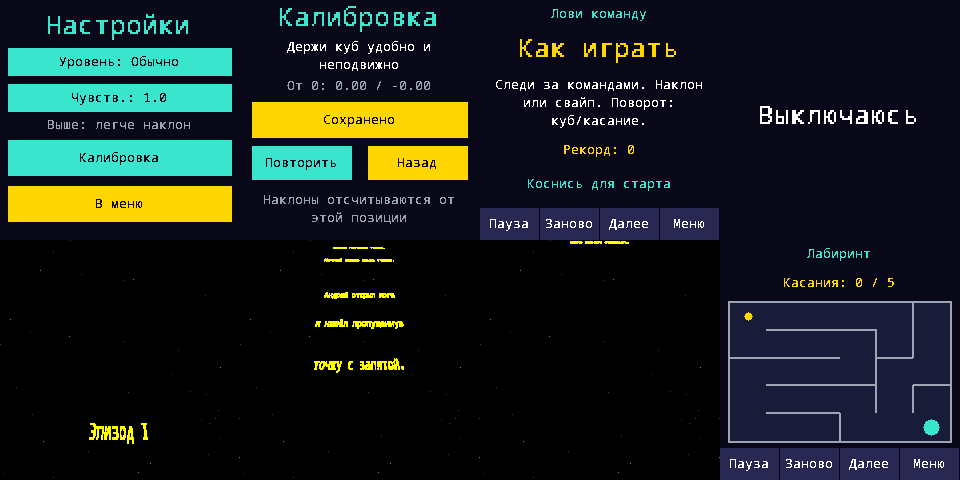
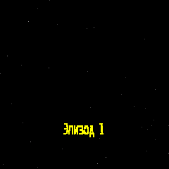
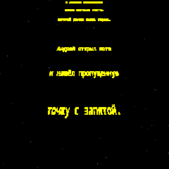
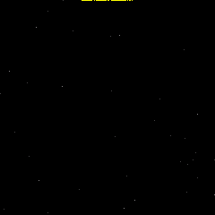

# Доработка аппаратной приёмки — 0.3.3, 21.10.2026

Основание: [задание](../tasks/hardware-acceptance-followup-0.3.2.md). Реализация в codex/neurocube-mvp; merge не выполнялся.

## Причины и изменения

- POWER: Board::sample не передавал KEY_PWR в InputFrame. Восстановлено чтение активного LOW GPIO24. GPIO28 снимается только после успешного flush, показа точной заставки и отпускания PWR. Схема D5/Q2/T1 и официальный пример изучены; подробности в [hardware](../hardware.md). Новые аппаратные действия не выполнялись.
- GAME-002: hitbox не пересекался с панелью; прежний переход менял лишь seed на том же экране. Теперь запускает новую карту немедленно. Это исправление наблюдаемого UX, не доказательство отсутствия проблем физического тача.
- IDLE: в прежней проекции первый кадр не имел текста, большая часть хвоста эпизода сжималась у верхнего края; большой dt мог перескочить анимацию. Изменены проекция, стартовый progress и ограничение dt. Точную причину пользовательского чёрного LCD без state captures прежней версии утверждать нельзя.
- Калибровка выводит нейтральные отклонения вместо сырых X/Y. Чувствительность объяснена; пороги не менялись.
- Commands: свайпы 22 px по доминирующей оси, начало только между командой и подсказкой; одно срабатывание до отпускания. Для поворота/касания остаётся touch круга. IMU-допуски сохранены.
- Hard maze: 8×5 вместо 7×5, +14% клеток, геометрия коридоров проверена радиусом шара. Easy/Normal алгоритм не менялся; субъективная трудность NOT_TESTED.

## Проверки

VERIFIED_IN_SIMULATOR: native suite — 100640359 assertions, включая 6000 seed (1932/2000/2000 разных карт), связность/детерминизм/коридоры, 300 полных прохождений игровой физикой. Это программная модель, не движения реальной платы. Новые регрессии: короткий/стартовый/длинный PWR, flush до cutoff, отказ записи, отсутствие present acknowledgement, выдержка кадра и отпускание PWR, восстановление при продолжающемся питании; свайпы всех направлений; центр/углы кнопок и новая карта на pause/result. Старые проверки calibration save/reload, жестов, record v3 и всех игр сохранены. 14 Python tests архитектуры и UF2 прошли.

Галерея симулятора ниже: Settings, нейтраль, Commands rules, shutdown; начало/середина/конец crawl и новая карта. На последнем кадре титры уже почти ушли; затем тест проверяет fade и dark. Это framebuffer симулятора, не фотография LCD.

COMPILED_ONLY: ARM UF2; валидатор защищает оба сектора record journal и reserved E10 page. 0.3.3 не загружена до отдельного разрешения. На исходной 0.3.2 read-only USB подтвердил serial 419CB819454EA93D, revision 8edc20c35597, sequence 20, i2c_errors 0. Физическая автономность 5+ минут была подтверждена пользователем ранее и не заменяет проверку нового выключения.

NOT_TESTED: BAT_EN LOW на реальной плате, battery poweroff/cold start, видимые титры/подсветка и новый touch UX. [Повторный чек-лист](../morning-checklist.md). Перед разрешённой прошивкой снять свежие records/settings и резервную копию journal; не использовать прежний sequence как ожидаемый, поскольку пользователь играет.

## Собранный артефакт

Исходный коммит `90bfda3b6376909dba551c7a4fba087944278c8f`. UF2 412672 байт, SHA256 `0d86e06ec8a81f67bff6f51500d28394aceda4a92567d6609adbfc9cb95549fd`. [Машиночитаемая запись](acceptance-0.3.3-build.json). GitHub Actions для исходного коммита: [run 39614080335](https://github.com/odinesn1ck/neurocube/actions/runs/39614080335); статус CI проверяется отдельно, локальный успех не подменяет его.

Сборка 0.3.3: [предварительный релиз и UF2](https://github.com/odinesn1ck/neurocube/releases/tag/v0.3.3-rc1). Исходный коммит `90bfda3b6376909dba551c7a4fba087944278c8f`; контрольные суммы и Windows-симулятор приложены. Статус аппаратной проверки — NOT_TESTED, на плату этот релиз пока не установлен.

## Обновление: установка после разрешения пользователя

0.3.3 установлена на serial 419CB819454EA93D; проверены BOOTSEL serial и прежний LocationPath. SHA256 UF2 совпал с опубликованным выше, picotool load -v завершён OK. Предварительно сохранены records/settings JSON и 8192 байта journal вне Git; SHA256 journal `7bea752f79117305d527a810fd0106ee5a2d1029ee7a120b807f28df6bae0f97`. [Read-only USB smoke](acceptance-0.3.3-usb-smoke.json) прошёл, включая полное равенство records/settings, sequence 20. Прежние отметки «не прошито» описывают состояние при сборке. Физический PWR, холодное включение и видимый LCD ещё NOT_TESTED.

## Естественный crawl на установленной 0.3.3

Read-only USB наблюдал штатный цикл меню без действий: Awake → Crawl → Fading → Dark. Сняты framebuffer начала, середины и конца; в Crawl PWM=256, в Dark PWM=0 и screen=12. [Сырые фазы/PWM и кадры](acceptance-0.3.3-crawl-usb.json). Это VERIFIED_ON_HARDWARE только для исполнения прошивки, framebuffer и регистров; видимый LCD, touch/PLUS wake и батарейное выключение остаются NOT_TESTED.

## Физическое подтверждение пользователя

После установки 0.3.3 и инструкции «отключить USB → удержать PWR до “Выключаюсь” → отпустить → включить PWR» пользователь ответил: «работает». Это VERIFIED_ON_HARDWARE по сообщению пользователя для сценария выключения и последующего включения. P0 POWER shutdown принят. Подтверждение не распространяется автоматически на все игровые исправления, видимый crawl, оба способа wake или отдельную проверку QR: детальной разбивки ответа нет. Исторические NOT_TESTED выше описывают состояние до этого ответа.
