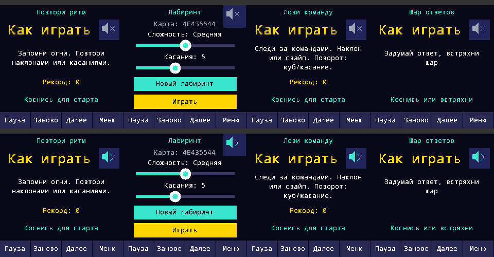

# Тихие игровые эффекты — 0.3.4, 21.10.2026

Основание: [game-audio-effects](../tasks/game-audio-effects.md). Пользователь подтвердил штатный звук, но прежний писк оказался очень громким. Он не повторялся.

## Реализация

- Game публикует ErrorOccurred / AnswerAccepted ровно при переходе; App потребляет события даже при mute. Один AudioOutput. Ошибка Simon и Commands (включая timeout) — 100-мс «кх», превышение лимита лабиринта — такой же эффект. Не проигрышный контакт без звука. Новый принятый запрос Magic Ball — 180-мс «уоп», включая shake с Rules; фазы появления текста и отклонённые запросы не создают событий.
- Синтез: 24 кГц, 16-битные одинаковые L/R, LUT-синус, мягкая атака 6 мс и затухающая огибающая. Error: спад 210→95 Гц с небольшой долей шумовой составляющей; Answer: округлый подъём 220→420 и спад до 300 Гц. PCM peak ограничен 64 вместо 8191 прежнего теста, codec volume=60 остаётся прежним. Это не акустическое измерение; достаточная слышимость и комфорт NOT_TESTED.
- Усилитель NS4150B GPIO0, I2S в ES8311 GPIO1, MCLK3, BCLK4/LRCK5, I²C1 6/7. Тип излучателя в корпусе программно не определён; его наличие на фактической сборке подтверждено пользователем ранее. Подсветка GPIO13, питание GPIO28 и кнопки не переназначаются.
- Один голос: busy отклоняет новое событие без очереди. DMA читает фиксированный RAM-буфер 17280 байт. По окончании DMA IRQ выключает PA; независимый alarm ограничивает PA 240 мс. CPU не ждёт воспроизведения. Foreground завершает mute DAC/остановку MCLK; pause/menu/restart/mute и shutdown вызывают stop. Отказ I²C/DMA/alarm оставляет PA выключенным.
- Пиктограмма динамика с волной / перечёркиванием на Rules; Maze использует свой существующий MazeSetup вместо отдельного Rules, пиктограмма добавлена туда без изменения перехода игры. Hitbox 40×40 / 44×44. Касание только меняет sound_enabled, удержание поглощается, start/shake не проходят в том же событии.
- По умолчанию OFF, в том числе на всех старых сохранениях. v3 не меняет версию/512 байт/сектора/CRC. Маркер 0x534E4400/1 в резерве 436..439: отсутствующий/неизвестный означает mute. Старый reader игнорирует маркер; старый writer вернёт mute, сохраняя прежние данные. Записи только по изменению настройки, штатный sequence и flash readback сохранены.

## Программные проверки

Native проверяет события ровно один раз, отсутствие событий на contact без проигрыша и повторной анимации, таймаут и неверный ввод, shake-start, mute, icon touch/debounce, глобальность и reload, остановку при shutdown. Проверяются waveform duration/peak/нулевые края/без наложений mock, frozen pre-audio v3 с FF-резервом, v1/v2, CRC и неизменность всех прежних полей. Старые тесты игр/лабиринта/рекордов сохраняются.

Галерея — framebuffer Windows-симулятора, не LCD. SimAudio — mock, звуки на компьютере автоматически не проигрываются. Сборка ARM/UF2 — COMPILED_ONLY до разрешённой установки; новый профиль на плате ещё не запускался. Native и CI не подтверждают комфорт громкости или реальное сохранение настройки на плате. [Физический чек-лист](../morning-checklist.md).
