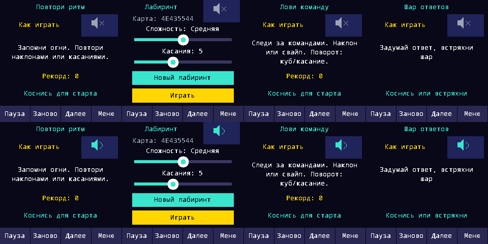

# Аудио и сенсорная кнопка — 0.3.4-rc3

Пользователь запросил увеличение громкости на 25% и сообщил о промахах/старте игры при попытке переключить звук.

PCM peak 1024→1280 (+25% цифровой амплитуды), codec volume 60 и выдержки усилителя 180/120 мс сохранены. Это не обещание +25% воспринимаемой акустической громкости. Звуки приветствия/выключения остаются независимыми от игрового mute; игровой звук по умолчанию ON, явный OFF сохраняется. Игры, питание и формат журнала не менялись.

Видимая кнопка 72×44 вместо 40×40 (Maze ранее 44×44); область ввода 88×48. Центр пиктограммы сдвинут внутрь экрана. Заголовок правил и подписи лабиринта размещены без перекрытия. Новый raw touch переключает звук даже при подавленном tap; уже удерживаемый контакт после входа из меню не переключает его. После захвата контакт поглощается до полного отпускания, включая перенос на старт и release-tap.

VERIFIED_IN_SIMULATOR: 10152 audio checks, полный native core suite, 14 Python tests. Новые регрессии проверяют четыре края расширенной области во всех четырёх играх, raw touch без tap, удержание/перенос/release-tap, повторное переключение и вход из меню с удерживаемым пальцем.

Галерея — framebuffer симулятора, не фото LCD. CI исходного c90b616 завершён успешно; [UF2/комплект](https://github.com/odinesn1ck/neurocube/releases/tag/v0.3.4-rc3), [паспорт](game-audio-0.3.4-rc3-build.json).

После явного разрешения пользователя rc3 установлена на serial 419CB819454EA93D с проверкой serial/topology и picotool verify. Перед записью сохранён свежий журнал 8192 байта вне Git. [Flash report](game-audio-0.3.4-rc3-flash.json) подтверждает полное совпадение рекордов и прежних настроек; [USB smoke](game-audio-0.3.4-rc3-usb-smoke.json) пройден. Аудио готово, peak=1280, played=1 (сигнал приветствия), faults=0. Это электронная проверка, не подтверждение слышимости человеком. Физическая проверка новой кнопки и оценка громкости пользователем ещё NOT_TESTED.
