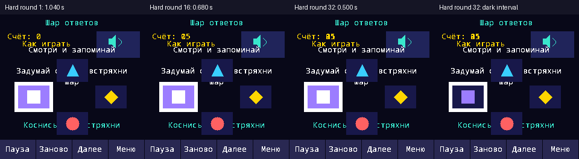

# Плавная скорость Simon — 22.10.2026

Основание: [задание](../tasks/simon-progressive-speed.md). Входит в 0.3.5 вместе с ранее реализованными [сигналами контактов/успехов](game-feedback-audio-0.3.4-rc4.md).

Чистая функция sequence_signal_seconds(Difficulty, round) хранит параметры в одном месте: начальные 1.40/1.22/1.04 с, уменьшение на 0.024 с за пройденный раунд, минимум 0.50 с, диапазон раундов 1..32. В start сохраняется сложность и задаётся скорость первого раунда; после завершения Correct перед следующим Showing она пересчитывается. Все сигналы одного показа имеют одинаковую скорость. Подсветка 65%, погасание 35%; при минимуме это 325/175 мс. Пауза Correct 360 мс, пауза перед показом 700 мс и App 3–2–1 сохранены. В Recall нет тайм-аута. Restart сбрасывает длину и скорость, pause/resume их сохраняют.

## Фактическая скорость

Таблица напечатана native-тестом, вызывающим ту же игровую функцию, что и прошивка. Значения — полный интервал сигнала, включая погасание.

| Раунд | Легко, с | Обычно, с | Сложно, с |
|---|---:|---:|---:|
| 1 | 1.400 | 1.220 | 1.040 |
| 5 | 1.304 | 1.124 | 0.944 |
| 10 | 1.184 | 1.004 | 0.824 |
| 15 | 1.064 | 0.884 | 0.704 |
| 20 | 0.944 | 0.764 | 0.584 |
| 25 | 0.824 | 0.644 | 0.500 |
| 32 | 0.656 | 0.500 | 0.500 |

## Проверки

VERIFIED_IN_SIMULATOR: 2986825 проверок нового suite. Для каждой сложности и двух seed пройдены все 32 раунда: число вспышек и префиксы, постоянный step внутри раунда, интервалы 65/35, состояния Showing/Recall/Correct/Failure/Complete, детерминизм, рестарт, pause/resume. Час ожидания в каждом Recall не вызывает проигрыша. На каждом раунде отдельная копия проверяет неверный ответ и Failure. Кадры с активной и погасшей фигурой различаются, включая раунд 32.

10757 audio checks и полный core suite пройдены; 14 Python tests пройдены. Симулятор автоматически прошёл 32 раунда и сохранил кадры 1/16/32 на Hard; это программные framebuffer, не фото LCD.

UF2 и CI готовятся. Физическая удобность поздних раундов NOT_TESTED до подтверждения пользователя. На плате пока rc3 / c90b616. Формат рекордов, питание, аудио HAL и прочие игры в этапе Simon не менялись; звуковые дополнения лежат отдельным предыдущим коммитом.

## Приёмка после разрешённой установки

1. На трёх сложностях проверить 3–2–1, начальную скорость, подсветку и промежутки погасания.
2. Пройти несколько раундов: ускорение между показами, одинаковый темп внутри показа. Отдельно оценить поздние быстрые раунды на LCD.
3. В своей очереди подождать, затем ответить: нет проигрыша по времени. Пауза сохраняет темп, «Заново» возвращает начальный.
4. Проверить наклоны/сенсор, прежние рекорды, сигналы касаний/успехов и общий mute. Питание PWR и автономность должны сохранять прежнее поведение.
